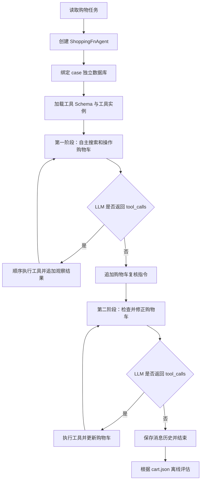

# Shopping Baseline Agent：ReAct 执行逻辑

`shoppingplanning/agent/shopping_agent.py` 实现了一个**两阶段、单 Agent、基于 Function Calling 的 ReAct 风格购物 Agent**。它没有独立 Planner、Critic 或搜索树；搜索、比较和购物决策主要由模型根据 system prompt 自主完成。

## 整体流程



## 初始化

每个测试样本创建一个独立的 `ShoppingFnAgent`，并绑定到：

```text
database_dir/case_{sample_id}/
```

Agent 初始化时完成：

1. 加载 `.env` 中尚未设置的环境变量。
2. 确定模型名称和当前 case 数据库路径。
3. 加载 `shopping_tool_schema.json`。
4. 将 Schema 转换为 OpenAI Function Calling 格式。
5. 导入工具包，通过 `TOOL_REGISTRY` 创建工具实例。

Agent 同时维护：

- `openai_tools`：提供给模型的工具定义。
- `tool_instances`：Python 中实际执行的工具对象。
- `messages`：完整对话与工具调用历史。
- `cart.json`：购物环境的实际状态和最终结果。

## 工具系统

工具分为四类：

| 类别 | 工具 |
|---|---|
| 搜索 | `search_products` |
| 过滤与排序 | `filter_by_brand`、`filter_by_color`、`filter_by_size`、`filter_by_range`、`filter_by_applicable_coupons`、`sort_products` |
| 信息查询 | `get_product_details`、`get_user_info`、`calculate_transport_time` |
| 环境操作 | `add_product_to_cart`、`delete_product_from_cart`、`get_cart_info`、`add_coupon_to_cart`、`delete_coupon_from_cart` |

具体工具通过 `@register_tool(name)` 注册。Agent 导入 `shoppingplanning/tools` 后，从注册表中为当前 case 创建实例。

模型看到的是工具 JSON Schema，真正的执行入口是工具实例的 `call()`。工具异常不会直接中止 Agent，而是转换为 JSON 错误消息，让模型在下一轮调整策略。

## 第一阶段：ReAct 循环

初始消息由 system prompt 和用户查询组成：

```python
[
    {"role": "system", "content": system_prompt},
    {"role": "user", "content": user_query}
]
```

每一轮执行：

```text
LLM 接收完整消息历史和工具定义
→ 返回普通文本或 tool_calls
→ Agent 解析 tool_calls
→ 顺序执行工具
→ 将工具结果作为 observation 加入消息历史
→ 进入下一轮
```

伪代码如下：

```python
for step in range(max_llm_calls):
    response = call_llm(messages, tools)
    messages.append(response)

    if not response.tool_calls:
        break

    for tool_call in response.tool_calls:
        result = execute_tool(tool_call)
        messages.append(result)
```

典型轨迹为：

```text
理解用户需求
→ 查询用户尺码、地址或优惠券
→ 搜索候选商品
→ 按属性过滤
→ 查询商品详情
→ 比较价格或优惠方案
→ 添加或删除购物车商品
→ 查询购物车状态
→ 输出阶段性结果
```

第一阶段的唯一停止条件是模型不再返回工具调用。代码不会主动验证购物车是否满足需求、预算或全局最优性。

## 第二阶段：购物车复核

第一阶段结束后，Agent 无条件追加一条 user 消息，要求模型：

- 检查购物车是否满足原始需求；
- 缺少商品时补齐；
- 存在多个方案时选择最优方案；
- 以购物车中的内容作为最终结果；
- 已经完成时停止。

随后使用相同模型、工具和历史再次运行 ReAct 循环。

这个阶段属于轻量的 self-refinement，但不是独立 Critic：模型仍然依据自己的历史和判断复核，不会访问隐藏 ground truth 或评估结果。

## 三个 Level 的策略差异

三个 Level 使用相同 Agent 实现，仅 system prompt 和数据不同：

| Level | 目标 |
|---|---|
| Level 1 | 找到满足需求的最低价商品组合 |
| Level 2 | 满足商品需求和预算约束，并选择最低价组合 |
| Level 3 | 联合选择商品和优惠券，使折后价格最低 |

Level 3 可能需要选择标价稍高但能触发更优优惠券的商品，因此是商品组合与优惠券组合的联合优化问题。当前实现没有程序化求解器，最优性完全依赖模型推理。

## 调用预算

第一阶段和第二阶段分别拥有完整的 `max_llm_calls` 预算，因此：

```text
最大 Agent 层模型调用数 = 2 × max_llm_calls
```

例如设置 `max_llm_calls=50` 时，每个 case 最多进行 100 轮 Agent 模型调用。API 重试次数不计入这个预算，实际 HTTP 请求数可能更高。

如果第二阶段最后一轮仍然返回工具调用，Agent 会执行工具后直接返回。最终消息为 `tool`，评估器会将该 case 判定为未完成。

## 并发与隔离

`run_agent_inference()` 使用 `ThreadPoolExecutor` 并发处理不同 case：

```text
case_1 → Agent 1 → case_1/cart.json
case_2 → Agent 2 → case_2/cart.json
case_3 → Agent 3 → case_3/cart.json
```

并发单位是 case。单个 case 中的多个工具调用按顺序执行。由于每个 case 使用独立数据库目录，不同 Agent 原则上不会修改同一购物车。

批量结果按照任务完成顺序收集，不保证与输入顺序一致。

## 轨迹保存

Agent 在初始状态、每次模型响应和每次工具执行后，将完整历史覆盖保存到：

```text
case_{sample_id}/messages.json
```

文件结构为：

```json
{
  "step": 3,
  "description": "Tool execution completed - 1 tools",
  "messages": []
}
```

保存的是当前完整快照，不是增量日志。现有实现可用于调试，但不支持自动从中断位置恢复。第二阶段的步骤编号会重新从 1 开始。

## 成功与评估

只要 `agent.run()` 没有抛出异常，推理结果就标记为：

```python
"success": True
```

它只表示执行过程没有异常，不表示购物任务正确。以下状态可以同时出现：

```text
推理 success = True
Agent 已停止 = True
购物车得分 = 0
```

最终结果由评估器读取 `cart.json`，比较购物车中的商品和优惠券与 `validation_cases.json` 中的参考答案。

## 主要局限

1. **没有程序化完成条件**：模型停止调用工具就结束当前阶段。
2. **没有全局优化保证**：最低价商品组合和优惠券组合完全依赖模型推理。
3. **复核不独立**：第二阶段仍使用同一个模型和同一段历史。
4. **调用上限翻倍**：`max_llm_calls` 实际是每阶段预算。
5. **工具加载错误可能被忽略**：Schema 中的工具可能没有对应可执行实例。
6. **完整历史持续增长**：没有摘要或上下文裁剪机制。
7. **每次调用重新创建模型客户端**：增加了重复初始化开销。
8. **推理成功定义宽松**：未验证购物车内容或是否自然结束。
9. **默认路径不准确**：直接实例化 Agent 而不传路径时，默认工具和数据库路径可能指向 `shoppingplanning/agent` 下的错误位置。

## 定位

该 baseline 可以概括为：

> Prompt-guided two-pass function-calling ReAct agent with persistent cart state.

即：由 prompt 指导的两阶段工具调用 Agent，以完整消息历史作为记忆，以 `cart.json` 作为持久化环境状态，通过同一模型的第二次执行完成购物车复核。
