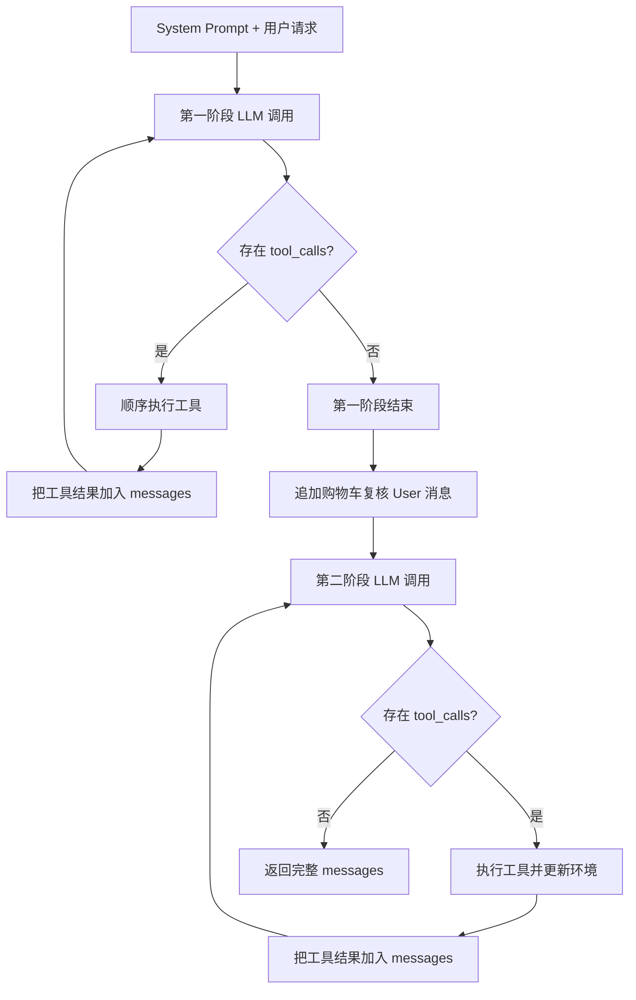

# Shopping Agent 的 ReAct Loop 逻辑

`shoppingplanning/agent/shopping_agent.py` 中的 `run()` 包含两个连续的 Function Calling 循环：第一阶段自主完成购物任务，第二阶段检查并修正购物车。

## 整体结构



简化后的伪代码：

```python
messages = [system_message, user_message]

# 第一阶段：执行购物任务
for step in range(max_llm_calls):
    response = call_llm(messages, tools)
    messages.append(response)

    if not response.tool_calls:
        break

    for tool_call in response.tool_calls:
        result = execute_tool(tool_call)
        messages.append(result)

# 第二阶段：复核购物车
messages.append(cart_check_user_message)

for step in range(max_llm_calls):
    response = call_llm(messages, tools)
    messages.append(response)

    if not response.tool_calls:
        return messages

    for tool_call in response.tool_calls:
        result = execute_tool(tool_call)
        messages.append(result)

return messages
```

## 每一轮承接的信息

每次调用模型时都会传入从任务开始到当前时刻的完整 `messages`，没有摘要或上下文裁剪。

消息历史包括：

1. 原始 system prompt。
2. 原始用户购物请求。
3. 之前所有 assistant 文本。
4. 之前所有 assistant 工具调用。
5. 每个工具调用的返回结果。
6. 模型返回的 `reasoning_content`，如果存在。
7. 第二阶段开始时追加的购物车复核指令。

示例：

```json
[
  {
    "role": "system",
    "content": "寻找满足需求的最低价商品组合"
  },
  {
    "role": "user",
    "content": "购买一双适合我的黑色跑鞋"
  },
  {
    "role": "assistant",
    "content": "",
    "tool_calls": [
      {
        "id": "call_1",
        "type": "function",
        "function": {
          "name": "get_user_info",
          "arguments": "{}"
        }
      }
    ]
  },
  {
    "role": "tool",
    "tool_call_id": "call_1",
    "content": "{\"shoe_size\": 42}"
  }
]
```

下一轮模型可以据此知道用户尺码、已经使用过的工具及其返回结果。

## 三类跨轮状态

### 1. 消息状态

`messages` 保存 Agent 的认知和观察历史，包括模型做过的查询、收到的结果和输出的文本。

代码没有单独维护结构化的任务计划、候选集、预算余额或已完成需求列表。这些信息只能由模型从消息历史中重新理解和计算。

### 2. 工具实例状态

工具实例在 Agent 初始化时创建一次：

```python
self.tool_instances = self._load_tool_instances()
```

每轮使用相同的工具对象，因此工具内部加载的商品数据、路径和可能存在的缓存可以跨轮保留。

### 3. 环境状态

购物车工具直接修改：

```text
database_dir/case_{sample_id}/cart.json
```

因此环境状态独立于消息历史长期存在：

```text
messages = Agent 的认知和观察历史
cart.json = 购物环境的实际状态
```

最终评估读取 `cart.json`，而不是依据模型最终文本判断购物结果。

## 单轮工具调用

模型一轮可以返回多个工具调用。Agent 会按照返回顺序逐个执行，并将所有工具结果加入 `messages` 后再调用下一轮模型。

工具调用与返回结果通过 `tool_call_id` 对应：

```text
assistant.tool_calls[id=call_1]
                 ↓
tool[tool_call_id=call_1]
```

工具执行异常不会直接终止循环，而是转换为 JSON 错误结果：

```json
{
  "error": "具体错误"
}
```

下一轮模型可以读取错误信息并调整参数或改用其他工具。

## 第一阶段如何停止

第一阶段的自然停止条件是：

```python
if not calls:
    break
```

即模型返回一条没有 `tool_calls` 的 assistant 消息时，第一阶段结束。

例如：

```json
{
  "role": "assistant",
  "content": "已经找到最低价商品并加入购物车。"
}
```

第一阶段有两种停止方式：

1. **模型主动停止**：返回非空文本且没有工具调用。
2. **达到调用上限**：完成 `max_llm_calls` 轮后循环自然结束。

第一阶段无论以哪种方式停止，都会进入第二阶段。

代码不会在第一阶段结束时验证购物车是否正确、是否满足预算或是否达到全局最优。

## 第二阶段承接什么

第一阶段结束后，`_add_to_cart()` 在完整历史末尾追加新的 user 消息，要求模型：

- 检查购物车是否满足原始需求；
- 缺少商品时补齐；
- 存在多个方案时选择最优方案；
- 以购物车内容作为最终结果；
- 已完成时停止。

第二阶段继承：

- 第一阶段全部消息；
- 第一阶段全部工具调用和返回结果；
- 第一阶段修改后的 `cart.json`；
- 相同的 system prompt；
- 相同的工具实例；
- 新增的购物车复核要求。

`_add_to_cart()` 对消息列表执行浅拷贝。列表本身是新的，原有消息对象没有深拷贝，但后续代码不会修改旧消息，因此通常没有影响。

## 第二阶段如何停止

第二阶段的自然停止条件同样是没有工具调用：

```python
if not calls:
    return messages
```

区别在于：

- 第一阶段没有工具调用时 `break`，继续进入复核阶段。
- 第二阶段没有工具调用时直接 `return`，整个 Agent 结束。

第二阶段也可能因为执行完 `max_llm_calls` 轮而强制结束。如果最后一轮仍然调用了工具，Agent 执行工具后直接返回，最终消息将是 `tool`。

评估器把最后一条消息为 `tool`，或最后一个 assistant 消息仍包含 `tool_calls` 的 case 判定为未完成。

## Stop 的实际含义

当前 stop 只表示：

```text
模型没有继续返回 tool_calls
```

它不会检查：

- 购物车是否包含全部目标商品；
- 商品数量是否正确；
- 是否存在多余商品；
- 是否满足预算；
- 优惠券组合是否最优；
- 最终价格是否最低。

因此可能出现：

```text
模型停止调用工具
→ Agent 正常返回
→ is_completed = True
→ 最终购物车得分仍为 0
```

`is_completed` 表示协议层已经结束，不表示业务任务正确完成。

## 调用预算

两个循环各自拥有完整的 `max_llm_calls` 预算：

```text
第一阶段最多 max_llm_calls
+ 第二阶段最多 max_llm_calls
= 最多 2 × max_llm_calls 次 Agent 层模型调用
```

例如：

```text
max_llm_calls = 50
最大 Agent 层调用数 = 100
```

单次 `call_llm()` 内部的 API 重试不计入这个预算，所以实际 HTTP 请求数可能更高。

## 示例轨迹

```text
初始：
  system prompt
  user query

第一阶段第 1 轮：
  assistant → get_user_info
  tool → 返回用户尺码

第一阶段第 2 轮：
  assistant → search_products
  tool → 返回候选商品

第一阶段第 3 轮：
  assistant → filter_by_size
  tool → 返回符合尺码的商品

第一阶段第 4 轮：
  assistant → sort_products
  tool → 返回价格排序结果

第一阶段第 5 轮：
  assistant → add_product_to_cart
  tool → 修改 cart.json

第一阶段第 6 轮：
  assistant → 普通文本，无 tool_calls
  第一阶段停止

追加复核消息：
  检查购物车，缺少则补齐，存在多个方案时选择最优

第二阶段第 1 轮：
  assistant → get_cart_info
  tool → 返回当前购物车

第二阶段第 2 轮：
  assistant → 购物车已经满足要求，无 tool_calls
  第二阶段停止，run() 返回完整 messages
```

## 核心结论

`run()` 的循环机制可以概括为：

```text
完整 messages 承接模型的认知与工具观察
+ 持久化 cart.json 承接环境变化
+ 相同工具实例承接工具内部状态
+ 没有 tool_calls 作为自然停止信号
+ max_llm_calls 作为每阶段的强制停止上限
```
