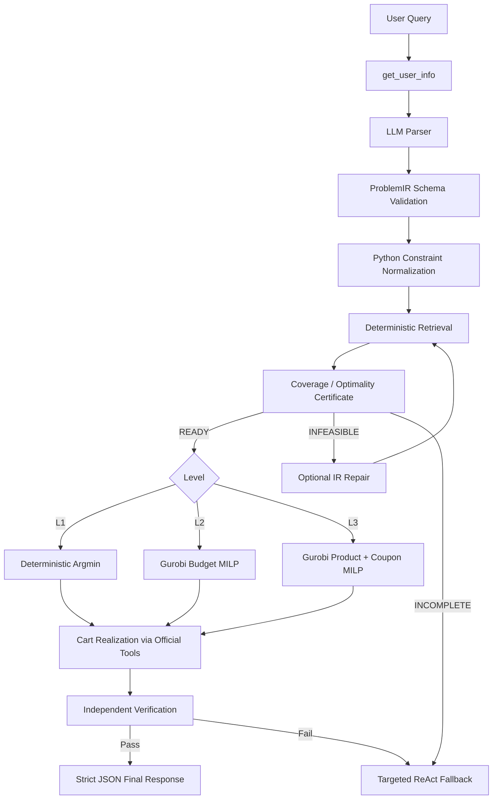

# Shopping Solver Agent 设计与运行说明

本文档说明当前仓库中两套购物 Agent 的实际实现和运行方法：

- **GurobiAgent**：`shoppingplanning/GurobiAgent/shopping_agent.py`
- **ReactAgent**：`shoppingplanning/reactAgent/shopping_agent.py`

统一入口是 `shoppingplanning/run.py`，通过环境变量 `SHOPPING_AGENT_BACKEND` 选择后端。

> 当前仓库没有名为 `gurobiagent.py` 的单文件。Gurobi 实现位于 `shoppingplanning/GurobiAgent/shopping_agent.py`。

## 1. 两套 Agent 的定位

| 维度 | GurobiAgent | ReactAgent |
|---|---|---|
| 核心思想 | LLM 负责自然语言到 ProblemIR，Python 负责检索、覆盖证明、建模、执行和验证 | LLM 在消息历史中持续推理并自主选择工具 |
| 状态表示 | 显式 `ProblemIR`、candidate memory、coverage certificate、solution、verification | 主要依赖完整对话历史和工具 observation |
| 检索 | Python 通过官方 filter/sort/detail/transport tools 确定性执行 | LLM 自主决定搜索、过滤、详情查询和停止时机 |
| Level 1 求解 | 每个 slot 的确定性最低价 `argmin` | LLM 自己比较候选并操作购物车 |
| Level 2 求解 | Host-side Gurobi MILP，处理预算约束 | ReAct 推理 |
| Level 3 求解 | Host-side Gurobi 产品与优惠券 MILP | ReAct 推理 |
| 购物车执行 | 根据 solution 计算 cart delta，确定性调用官方工具 | LLM 调用 add/delete/cart tools |
| 验证 | 约束、覆盖、购物车、预算、优惠券和 objective 的结构化验证 | LLM 读取购物车后自行判断 |
| 失败处理 | 带具体错误上下文的 targeted ReAct repair | 第二轮通用购物车修复 loop |

## 2. GurobiAgent 总体框架



代码通过三层类组合实现：

```text
StructuredPlanningMixin
        ↓
StructuredShoppingFnAgent
        ↓
ShoppingFnAgent
```

- `StructuredPlanningMixin`：ProblemIR、候选判断、coverage、Level 1 逻辑及枚举 oracle。
- `StructuredShoppingFnAgent`：工具加载、LLM 调用、cart realization、verification、fallback 和主 `run()`。
- `ShoppingFnAgent`：真正的 host-side Gurobi Level 2/3 模型，覆盖 mixin 中同名求解方法。

### 2.1 Parse：自然语言编译成 ProblemIR

GurobiAgent 中 LLM 的主要职责是：

```text
Natural Language → ProblemIR JSON
```

ProblemIR 的基本形态是：

```json
{
  "slots": [
    {
      "slot_id": 1,
      "quantity": 1,
      "constraints": [
        {
          "field": "brand",
          "op": "==",
          "value": "Nike",
          "source_text": "from Nike"
        }
      ]
    }
  ],
  "global_constraints": {
    "budget": {"min": null, "max": null},
    "per_product": []
  }
}
```

Parser 后由 Python 完成：

1. 字段和操作符白名单校验；
2. slot ID、quantity 和 constraint schema 校验；
3. 全局 per-product constraint 向各 slot 传播；
4. Level 2/3 budget、coupon 等约束规范化；
5. user profile 的 gender、size 等默认语义解析；
6. 首次解析非法时，向 LLM 返回 validation error 并修复一次。

因此 LLM 不能直接决定最终商品，也不负责生成 Gurobi Python 源码。

### 2.2 Structured Memory

每个 case 独立维护结构化状态，核心内容包括：

```text
problem_ir
planning_memory.slots
planning_memory.candidates
planning_memory.transport_times
planning_memory.user_info
planning_memory.coupons
planning_memory.provenance / trace
coverage
solution
verification
metrics
```

候选判断采用三值逻辑：

```text
SAT      已知满足全部约束
UNSAT    已知违反至少一个约束
UNKNOWN  缺少运输时间或其他必要 observation
```

`UNKNOWN` 不会直接当成 `UNSAT`。如果缺少 transport time，系统会调用 `calculate_transport_time` 补齐后重新判断。

### 2.3 Deterministic Retrieval

GurobiAgent 的主检索路径不依靠 LLM 判断“搜够了没有”。Python 将每个 slot 的约束编译为：

- **hard predicates**：可由官方 filter tools 完整过滤；
- **soft predicates**：例如名称文本，用于语义优先级，不能单独定义候选全集；
- **late predicates**：必须取得详情或运输信息后验证。

典型流程是：

```text
filter_by_brand / color / size / range
→ sort_products(price asc)
→ get_product_details(batch)
→ calculate_transport_time(if needed)
→ SAT / UNSAT / UNKNOWN
```

名称搜索只调整 materialization 顺序，不把 semantic top-k 当成完整商品全集，避免因为 BM25 top-k 漏掉合法商品。

### 2.4 Coverage Certificate

每个 slot 的 coverage 会记录：

```json
{
  "feasible_candidate_found": true,
  "candidate_set_complete": false,
  "optimality_certified": true,
  "infeasible_certified": false,
  "total_count": 47,
  "retrieved_count": 6,
  "pages_exhausted": false,
  "sort_by": "price",
  "order": "asc",
  "all_cheaper_checked": true,
  "best_product_id": "...",
  "source_exhaustive": true
}
```

这几个概念彼此独立：

- `feasible_candidate_found`：至少找到了一个 SAT 商品；
- `candidate_set_complete`：候选集合已完整枚举；
- `optimality_certified`：即使没有枚举全集，也已验证所有更便宜商品均不可行；
- `infeasible_certified`：完整候选空间已经耗尽且不存在 SAT 商品。

Level 1 只需要每个 slot 都有 `optimality_certified=true`。Level 2/3 存在跨 slot coupling，要求候选集合完整枚举后才进入求解器。

Coverage 有三个总状态：

```text
READY
INFEASIBLE
INCOMPLETE
```

只有 `READY` 能进入确定性求解路径。

### 2.5 Level 1：Deterministic Argmin

Level 1 没有预算、优惠券或其他跨 slot coupling，因此：

\[
\min \sum_k price(p_k)
= \sum_k \min_{p\in C_k} price(p)
\]

系统直接对每个已证明充分的 slot 选择最低价候选：

```python
best = candidates[0]
```

Level 1 不创建 Gurobi model。这样避免使用 MILP 求解“从排序列表取第一个元素”。

### 2.6 Level 2：Gurobi Budget MILP

Level 2 使用 host-side `gurobipy` 建模。主要决策变量为：

\[
x_{kp}\in\{0,1\}
\]

表示 slot \(k\) 是否选择商品 \(p\)。核心约束包括：

\[
\sum_{p\in C_k}x_{kp}=1,\quad \forall k
\]

以及 ProblemIR 中的预算上下界：

\[
B_{min}\le \sum_{k,p}q_kc_{kp}x_{kp}\le B_{max}
\]

目标按优先级最小化 subtotal，并使用稳定的 product-ID tie-break，保证重复运行时结果尽量确定。

可设置：

```bash
SHOPPING_GUROBI_CROSSCHECK=1
```

让 Gurobi 结果与独立枚举 oracle 交叉检查，适合开发和模型验证；大批量测试时通常关闭以减少开销。

### 2.7 Level 3：产品与优惠券联合优化

Level 3 在产品选择基础上增加优惠券 plan 变量，处理：

- coupon ownership；
- VIP eligibility；
- threshold；
- coupon quantity；
- coupon scope；
- subtotal、discount 和 final price；
- budget 作用于 subtotal 或 final price 的语义。

当前实现先构造 benchmark-compatible coupon frontier，然后使用 indicator constraints 绑定 subtotal 与 coupon threshold 区间。

多目标优先级为：

1. 最小 final price；
2. 最小 subtotal；
3. 最少 coupon count；
4. 稳定 product-ID tie-break。

返回状态通常为：

```text
OPTIMAL_OVER_COMPLETE_CANDIDATE_SETS
```

### 2.8 Cart Realization

Solver 不直接写文件，也不让 LLM重新选择商品。它先读取官方购物车：

```text
get_cart_info
```

然后计算：

\[
\Delta Cart = Cart^* - Cart_{current}
\]

只执行必要的：

- `delete_product_from_cart`；
- `add_product_to_cart`；
- `delete_coupon_from_cart`；
- `add_coupon_to_cart`。

同一商品满足多个 slot 时，quantity 会聚合。

### 2.9 Verification 与 Fallback

Verifier 会检查：

- cart 商品和数量是否等于 solver solution；
- 每个商品是否仍满足对应 slot；
- Level 1 是否确实选择最低价 certified candidate；
- 优惠券所有权、数量、VIP 和 threshold；
- subtotal、discount、final price；
- 预算上下界；
- cart summary 是否等于模型计算结果。

验证失败时，系统不会把整个结构化状态丢掉，而是把以下内容交给 targeted ReAct repair：

```text
ProblemIR
selected_products
current_cart
verification_errors
```

正常成功时，最终 assistant message 是严格 JSON。

## 3. ReactAgent 框架

ReactAgent 保留原始两阶段 ReAct 策略。

### 第一阶段：自由检索与操作

每一轮执行：

```text
messages
→ LLM(tools=all tools)
→ assistant tool_calls
→ execute tools
→ append tool observations
→ next round
```

下一轮继承完整 `messages`，包括：

- system prompt；
- user query；
- 之前所有 assistant response；
- tool name 和 arguments；
- tool result；
- reasoning content（如果模型提供）。

停止条件是 LLM 返回零个 tool calls，或者达到 `max_llm_calls`。

### 第二阶段：购物车修复

第一阶段结束后，程序追加一条 `_add_to_cart()` 用户消息，要求检查购物车、补齐商品并选择最优方案，然后再执行一轮相同的 ReAct loop。

第二阶段同样在：

- LLM 返回零个 tool calls；或
- 达到 `max_llm_calls`

时停止。

ReactAgent 没有显式 ProblemIR、coverage certificate 或数学求解器。它的优点是灵活，缺点是：

- retrieval 和 cart mutation 混合；
- 停止由 LLM 决定；
- 无法证明候选完整性或最优性；
- 后续分析通常只能重新读取长消息历史。

## 4. Backend 选择

`shoppingplanning/run.py` 支持三种 backend：

| `SHOPPING_AGENT_BACKEND` | 实现 |
|---|---|
| `default` 或未设置 | `shoppingplanning/agent/shopping_agent.py` |
| `gurobi` | `shoppingplanning/GurobiAgent/shopping_agent.py` |
| `react` | `shoppingplanning/reactAgent/shopping_agent.py` |

必须显式设置 `gurobi` 才会运行 GurobiAgent。

## 5. 运行前准备

进入项目目录：

```bash
cd /Users/yitianchen/Work/TravelPlanning/DeepPlanning/Qwen-Agent/benchmark/deepplanning
```

数据目录：

```text
/Users/yitianchen/Work/TravelPlanning/DeepPlanning/data
```

建议显式设置：

```bash
export BENCHMARK_DATA_DIR=/Users/yitianchen/Work/TravelPlanning/DeepPlanning/data
```

模型 API 信息应已配置在 `.env` 和 `models_config.json`。检查 Gurobi：

```bash
python3 -c 'import gurobipy as gp; print(gp.gurobi.version())'
```

当前本机检查到的版本是：

```text
13.0.2
```

Level 2/3 还需要可用的 Gurobi license。

## 6. 运行 GurobiAgent

### 6.1 单个 case

推荐用 `cyt_test_run.sh`，它会复制独立数据库，避免污染源数据：

```bash
BENCHMARK_DATA_DIR=/Users/yitianchen/Work/TravelPlanning/DeepPlanning/data \
BENCHMARK_MODEL=deepseek-flash \
SHOPPING_AGENT_BACKEND=gurobi \
SHOPPING_LEVEL=1 \
SHOPPING_MAX_LLM_CALLS=50 \
bash cyt_test_run.sh 13
```

Level 2：

```bash
BENCHMARK_DATA_DIR=/Users/yitianchen/Work/TravelPlanning/DeepPlanning/data \
BENCHMARK_MODEL=deepseek-flash \
SHOPPING_AGENT_BACKEND=gurobi \
SHOPPING_LEVEL=2 \
bash cyt_test_run.sh 1
```

Level 3：

```bash
BENCHMARK_DATA_DIR=/Users/yitianchen/Work/TravelPlanning/DeepPlanning/data \
BENCHMARK_MODEL=deepseek-flash \
SHOPPING_AGENT_BACKEND=gurobi \
SHOPPING_LEVEL=3 \
bash cyt_test_run.sh 1
```

### 6.2 每个 Level 前 N 条

下面命令会对 Level 1/2/3 分别测试前 10 条：

```bash
BENCHMARK_DATA_DIR=/Users/yitianchen/Work/TravelPlanning/DeepPlanning/data \
BENCHMARK_MODEL=deepseek-flash \
SHOPPING_AGENT_BACKEND=gurobi \
SHOPPING_LEVELS="1 2 3" \
SHOPPING_SAMPLE_COUNT=10 \
SHOPPING_WORKERS=2 \
SHOPPING_MAX_LLM_CALLS=50 \
bash test_run.sh
```

只跑 Level 1 前 20 条：

```bash
BENCHMARK_DATA_DIR=/Users/yitianchen/Work/TravelPlanning/DeepPlanning/data \
BENCHMARK_MODEL=deepseek-flash \
SHOPPING_AGENT_BACKEND=gurobi \
SHOPPING_LEVELS="1" \
SHOPPING_SAMPLE_COUNT=20 \
bash test_run.sh
```

### 6.3 Retrieval budget 参数

Coverage retrieval 不消耗额外 LLM call，但会消耗本地 tool calls。可用参数：

```bash
SHOPPING_L1_REDUNDANCY=5
SHOPPING_MAX_CANDIDATES_PER_SLOT=200
SHOPPING_MAX_PRODUCT_DETAILS=1000
SHOPPING_MAX_RETRIEVAL_TOOL_CALLS=250
SHOPPING_COVERAGE_BATCH_SIZE=20
SHOPPING_SEMANTIC_PRIORITY_LIMIT=50
```

例如：

```bash
SHOPPING_AGENT_BACKEND=gurobi \
SHOPPING_LEVELS="1" \
SHOPPING_SAMPLE_COUNT=20 \
SHOPPING_L1_REDUNDANCY=5 \
SHOPPING_MAX_CANDIDATES_PER_SLOT=200 \
SHOPPING_MAX_PRODUCT_DETAILS=1000 \
SHOPPING_MAX_RETRIEVAL_TOOL_CALLS=250 \
bash test_run.sh
```

如果 retrieval budget 耗尽且 coverage 仍不充分，状态会是 `INCOMPLETE`，随后进入 targeted ReAct fallback。

## 7. 运行 ReactAgent

### 7.1 单个 case

```bash
BENCHMARK_DATA_DIR=/Users/yitianchen/Work/TravelPlanning/DeepPlanning/data \
BENCHMARK_MODEL=deepseek-flash \
SHOPPING_AGENT_BACKEND=react \
SHOPPING_LEVEL=1 \
SHOPPING_MAX_LLM_CALLS=50 \
bash cyt_test_run.sh 13
```

### 7.2 每个 Level 前 N 条

仓库已经提供 `test_react_run.sh`，它会设置：

```bash
SHOPPING_AGENT_BACKEND=react
```

运行 Level 1/2/3 各前 10 条：

```bash
BENCHMARK_DATA_DIR=/Users/yitianchen/Work/TravelPlanning/DeepPlanning/data \
BENCHMARK_MODEL=deepseek-flash \
SHOPPING_LEVELS="1 2 3" \
SHOPPING_SAMPLE_COUNT=10 \
SHOPPING_WORKERS=2 \
SHOPPING_MAX_LLM_CALLS=50 \
bash test_react_run.sh
```

只跑 Level 1 前 20 条：

```bash
BENCHMARK_DATA_DIR=/Users/yitianchen/Work/TravelPlanning/DeepPlanning/data \
BENCHMARK_MODEL=deepseek-flash \
SHOPPING_LEVELS="1" \
SHOPPING_SAMPLE_COUNT=20 \
bash test_react_run.sh
```

## 8. 公平对比两套 Agent

两次运行应固定：

- 相同模型；
- 相同 Level；
- 相同 case 数；
- 相同 `max_llm_calls`；
- 相同数据源；
- 尽量相同并发数。

GurobiAgent：

```bash
BENCHMARK_DATA_DIR=/Users/yitianchen/Work/TravelPlanning/DeepPlanning/data \
BENCHMARK_MODEL=deepseek-flash \
SHOPPING_AGENT_BACKEND=gurobi \
SHOPPING_LEVELS="1" \
SHOPPING_SAMPLE_COUNT=20 \
SHOPPING_WORKERS=2 \
SHOPPING_MAX_LLM_CALLS=50 \
bash test_run.sh
```

ReactAgent：

```bash
BENCHMARK_DATA_DIR=/Users/yitianchen/Work/TravelPlanning/DeepPlanning/data \
BENCHMARK_MODEL=deepseek-flash \
SHOPPING_LEVELS="1" \
SHOPPING_SAMPLE_COUNT=20 \
SHOPPING_WORKERS=2 \
SHOPPING_MAX_LLM_CALLS=50 \
bash test_react_run.sh
```

由于 LLM parser 和 ReAct 调用可能存在随机性，建议至少重复 3 次，再比较均值和方差。

## 9. 输出文件

`test_run.sh` 会为每次运行创建独立 batch：

```text
shoppingplanning/test_runs/cyt_test_levels_<timestamp>_<suffix>/
```

每个 Level 的隔离数据库和轨迹位于：

```text
shoppingplanning/test_runs/<batch>/level_<N>/database/case_<ID>/
```

主要文件：

```text
cart.json       最终购物车
messages.json   推理轨迹；GurobiAgent 还保存 planning_state
products.jsonl  该 case 商品库副本
user_info.json  用户信息副本
```

评测报告位于：

```text
shoppingplanning/result_report/<batch>_level<N>/summary_report.json
```

批处理终端会输出：

```text
level | exact cases | product/coupon matches | incomplete
```

其中：

- `exact cases`：整题完全正确率；
- `product/coupon matches`：商品与优惠券级匹配率；
- `incomplete`：没有形成完整结果的 case 数。

`run_agent_inference()` 中的 `success` / `execution_success` 只表示 Python 执行过程没有抛异常，不代表 benchmark 答案正确。最终准确率必须读取 evaluator 的 `summary_report.json`。

## 10. GurobiAgent 轨迹与指标

GurobiAgent 的 `messages.json` 中通常包含：

```json
{
  "planning_state": {
    "problem_ir": {},
    "coverage": {},
    "solution": {},
    "verification": {},
    "metrics": {}
  }
}
```

重点指标包括：

```text
parser_success
parser_attempts
llm_calls
retrieval_calls
product_details_requested
retrieved_products
verified_candidates
retrieval_coverage
retrieval_budget
solver_used
solver_status
solver_total_runtime
gurobi_runtime
oracle_runtime
realization_actions
verification_success
fallback_used
```

通过这些字段可以区分：

- parser 错误；
- 候选空间为空；
- retrieval budget 不足；
- coverage 未证明；
- Gurobi infeasible；
- cart realization 错误；
- verifier 失败；
- ReAct fallback 是否被触发。

## 11. 方法边界

GurobiAgent 的最优性声明是：

```text
catalog_under_problem_ir
```

含义是：在当前 ProblemIR 正确、官方工具返回完备、coverage certificate 成立的前提下，求解结果对该 catalog 最优。

它不能自动证明：

```text
ProblemIR 与用户自然语言意图完全等价
```

因此仍需同时观察：

- parser repair 次数；
- evaluator exact-product accuracy；
- constraint satisfaction；
- fallback rate；
- coverage READY / INCOMPLETE / INFEASIBLE 比例。

Level 3 的 coupon policy 还包含 ShoppingBench 特定的 threshold-first 规则。若迁移到真实电商环境，应重新定义 coupon stacking、scope 和 eligibility，而不是直接复用 benchmark policy。
