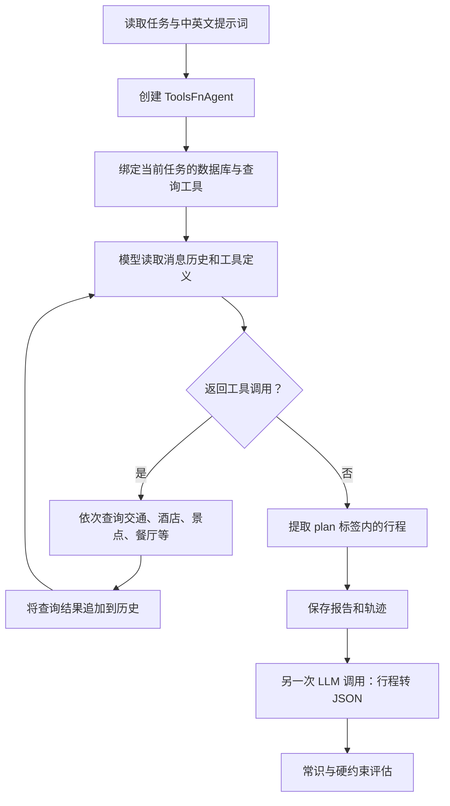

# Travel Agent 逻辑分析

当前 Travel Planning 的 Agent 类叫 **`ToolsFnAgent`**，位于 `travelplanning/agent/tools_fn_agent.py`。它是自定义的单 Agent 工具调用循环，整体流程为：**查询旅行信息 → 生成行程 → 转换为 JSON → 离线评估**。

## 1. 完整流程



**评估结果不会返回 Agent 触发行程修正。** 因此目前没有“生成 → 检查 → 修复”的闭环。

## 2. 工具如何绑定任务数据

`_build_tool_config()` 将每条任务绑定到：

```text
database_{zh/en}/id_{sample_id}/
```

工具根据类型读取不同文件：

| 工具类别 | 数据文件 |
|---|---|
| 火车、航班 | `trains/trains.csv`、`flights/flights.csv` |
| 酒店 | `hotels/hotels.csv` |
| 景点 | `attractions/attractions.csv` |
| 地点坐标 | `locations/locations_coords.csv` |
| 道路路线 | `transportation/distance_matrix.csv` |
| 餐厅 | `restaurants/restaurants.csv` |

与 Shopping 使用注册表不同，Travel 导入工具包后，通过 `BaseTravelTool.__subclasses__()` 找到直接子类并实例化。新增工具除了定义 schema，还需要确保工具类被导入、数据库映射正确。

这些工具主要提供查询能力，**行程安排、时间衔接、预算计算和方案选择都交给模型完成**，没有独立调度算法或求解器。

## 3. 模型执行循环

`ToolsFnAgent.run()` 只有一轮主循环，逻辑可以概括为以下伪代码：

```text
while llm_budget > 0:
    llm_budget -= 1
    response = call_llm(messages, tools)

    if response 有工具调用:
        顺序执行所有工具
        将结果加入 messages
    else:
        提取最终计划
        return final_plan, messages
```

关键行为：

- 每次传入完整消息历史，没有摘要或上下文裁剪。
- 同一轮多个工具调用顺序执行。
- 工具错误作为 JSON 返回，模型可以自行调整。
- 没有工具调用就结束，程序不会先检查行程是否完整或满足约束。
- 调用预算耗尽时，返回 `"Reached max LLM calls without final answer."`。

Travel 没有 Shopping 的额外复核阶段，因此 `max_llm_calls=50` 最多允许 50 次主循环模型调用。**API 重试和后续计划转换的模型调用不计入这个预算。**

## 4. 提示词与最终输出

`travelplanning/agent/prompts.py` 要求模型先查询信息，再用 `<plan>...</plan>` 输出包含每日活动、时间、费用等内容的行程。

提示词要求信息来自工具、名称严格匹配、预算与时间安排合理，但这些在 Agent 执行期间主要是文字约束。

`_extract_plan_content()` 会丢弃最后一个 `</think>` 之前的内容，再提取 `<plan>` 标签：

- 模型输出了行程，但没有 `<plan>` 标签：返回空字符串。
- 输出多个 `<plan>`：将其中的内容拼接。
- 没有执行行程结构或约束检查。

## 5. 保存、转换与评估

默认输出目录中，每条任务正常返回后，批处理函数保存轨迹和报告；后续转换、评估阶段产生对应结果：

```text
results/{model}_{language}/
  trajectories/id_0.json
  reports/id_0.txt
  converted_plans/id_0_converted.json
  evaluation/
```

Travel 的轨迹是在任务结束后保存，**没有 Shopping 那样每轮保存的机制**。如果中途发生异常，当前消息历史没有被异常处理分支写入轨迹文件。

`travelplanning/run.py` 再调用转换模块，使用所选模型将文本行程转换成标准 JSON。转换是独立的 LLM 处理步骤，不是 Agent 的工具。

评估随后检查：

- **常识约束**：按维度评分，同一维度中的检查全部通过才获得该维度分数。
- **硬约束**：全部通过才得到硬约束分数。

这意味着最终结果同时受**行程生成质量和文本转 JSON 的准确性**影响。

## 6. 当前最值得关注的问题

| 问题 | 实际影响 |
|---|---|
| 空计划仍可能被标记为 `success=True` | 推理成功率不能代表有效行程率 |
| 预算耗尽返回非空错误字符串 | 错误字符串会被保存为报告，后续可能跳过重新推理 |
| 缓存主要判断报告是否存在 | 已存在但无效的报告不会自动重新生成 |
| 工具加载、实例化异常被静默跳过 | 模型看到的 schema 与实际可执行工具可能不一致 |
| 非法工具参数 JSON 被替换成 `{}` | 隐藏解析错误，可能触发默认查询或模糊的缺参错误 |
| 批处理收到 `tool_schema_path`，却没有传给 Agent | 自定义 schema 路径实际不生效 |
| 缺失 tool call ID 时只修改执行侧 ID | assistant 原始消息与 tool 响应的 ID 可能不匹配 |
| 每轮不保存轨迹 | 中途失败时缺少完整诊断记录 |

另外，入口里的 `get_agent_inference_function(model)` 虽然描述为动态选择 Agent，实际始终返回同一个 `run_agent_inference`，目前没有按模型切换执行框架。

## 7. 改造成 Agentic Framework 的切入点

最直接的切入点是 `ToolsFnAgent.run()`。保留现有数据查询工具和批处理入口，将执行过程拆成：

```text
收集信息 → 生成结构化行程 → 检查约束 → 根据错误修正 → 输出
```

相比增加多个 Agent，当前更有价值的改造是：**明确区分有效计划、调用耗尽和执行失败；增加阶段保存；建立约束检查后的修正循环。**

如果接入现有评估器进行修正，需要把这种反馈作为新的实验设置说明，尤其不要向 Agent 暴露用于评分的参考答案或隐藏元数据。
